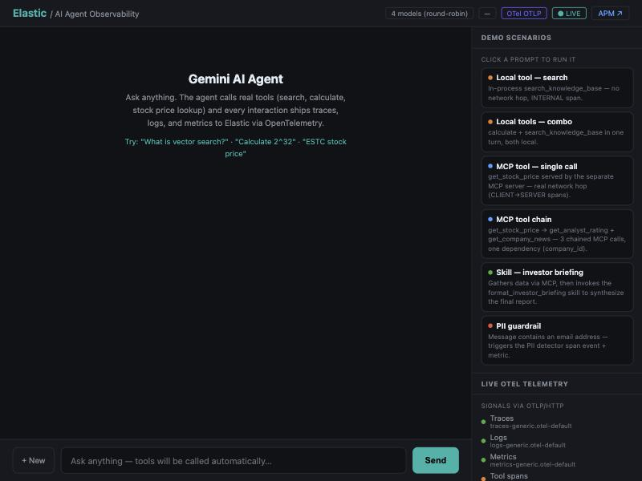
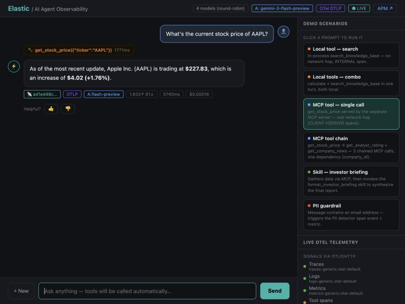
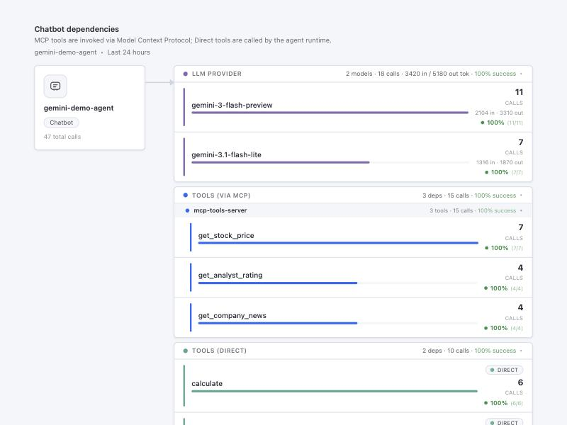

# AI Agent Observability — Elastic + OpenTelemetry

A live Gemini AI chat agent fully instrumented with the OpenTelemetry SDK.  
Every interaction ships **traces, logs, and metrics** via OTLP/HTTP to Elastic — exactly as a production service would.


> **⚠️ Requires an Elastic Cloud Serverless Observability project.** The optional Kibana
> dashboard panel in [`kibana/`](kibana/) uses a custom-visualization panel type (ES|QL +
> HTML render template) that is currently only available on Serverless — not on classic
> Elastic Cloud deployments or self-managed clusters. The chat agent itself (traces, logs,
> metrics via OTLP) works against any Elastic deployment that accepts OTLP/HTTP; only the
> dashboard panel specifically needs Serverless. See [`kibana/README.md`](kibana/README.md)
> for details.

| | |
|---|---|
|  |  |
| Demo scenario picker (right sidebar) | A triggered scenario — tool-call chip, trace ID, cost, APM link |

---

## What this demos

| Signal | Where it lands | What you see |
|--------|----------------|--------------|
| 📡 **Traces** | `traces-generic.otel-default` | Full waterfall: `invoke_agent gemini-demo-agent [INTERNAL]` → `execute_tool ... [INTERNAL or CLIENT]` → `generate_content gemini-3.1-flash-lite [CLIENT]` |
| 📋 **Logs** | `logs-generic.otel-default` | Structured logs with `trace_id` auto-correlated to every span |
| 📊 **Metrics** | `metrics-generic.otel-default` | `gen_ai.client.token.usage`, `gen_ai.client.operation.duration`, `mcp.client/server.operation.duration`, real CPU/memory via psutil |

**Service Map:** Kibana auto-discovers `gemini-demo-agent → google_gemini` (from `peer.service`) and `gemini-demo-agent → mcp-tools-server` (from the propagated MCP trace context).

**Full request/response:** Stored as structured `gen_ai.input.messages` / `gen_ai.output.messages` span attributes — no truncation, fully searchable via ES|QL.

**MCP server observability:** `get_stock_price` / `get_company_news` / `get_analyst_rating` are served by a separate process, [`mcp_server.py`](web_agent/mcp_server.py), over real MCP JSON-RPC (Streamable HTTP) — not called in-process. Both sides are instrumented per the [OTel MCP semantic conventions](https://github.com/open-telemetry/semantic-conventions-genai/blob/main/docs/gen-ai/mcp.md): the agent's `execute_tool` span carries MCP client attributes (`mcp.method.name`, `jsonrpc.request.id`, ...) and is the real parent — via W3C trace context injected into the MCP request's `params._meta`, not an HTTP header — of a `SERVER`-kind span in `mcp-tools-server`. One continuous distributed trace across two independently-deployed services, landing in the same Elastic indices.

---

## Architecture

```
🌐 Browser (Chat UI)
      │ HTTP POST /api/chat
      ▼
⚡ Python Server  ──── Gemini API call ───▶  🤖 Google Gemini
 (OTel SDK · psutil)                         (gemini-2.5-flash)
      │
      │ MCP JSON-RPC (tools/call, trace context in params._meta)
      ▼
🔧 MCP Tools Server  (separate process/service — mcp_server.py)
 (OTel SDK, SERVER spans)
      │
      │ OTLP/HTTP                              OTLP/HTTP
      ▼                                        ▼
☁️  Elastic Cloud  ◀──────────────────────────────
  ├── /v1/traces   → APM · Service Map · Waterfall (both services, one trace)
  ├── /v1/metrics  → Token usage · Latency · Host metrics
  └── /v1/logs     → Correlated logs · Discover · Alerts
```

---

## Quick start

### 1. Prerequisites

```bash
pip install google-genai opentelemetry-sdk opentelemetry-exporter-otlp-proto-http psutil httpx
```

### 2. Configure

> All configuration for this demo lives in **`web_agent/.env`** — there is no
> env file at the repo root. Create it from the template inside `web_agent/`:

```bash
cd web_agent
cp .env.example .env
# Edit web_agent/.env — see below for each value
```

**Gemini API key — set up a test environment, don't reuse someone else's key:**
1. Go to [Google AI Studio](https://aistudio.google.com/apikey) and sign in with any Google account.
2. Click **Create API key**. No billing is required — the free tier covers this demo
   comfortably (rate-limited, but that's fine for a demo).
3. Put the key in `.env` as `GEMINI_API_KEY`.

Generate **your own** key for this — never reuse a key you've seen pasted in a shared
screen recording, a chat transcript, documentation, or someone else's config file.
Treat any key that's ever left your own secrets manager as compromised, and regenerate
it in AI Studio if that happens.

**Elastic — OTLP ingest endpoint:** this demo ships OTLP/HTTP straight to Elastic's own
managed OTLP endpoint, **not** the raw Elasticsearch endpoint. In an Elastic Cloud
Serverless Observability project, find these under **Project settings → Manage this
project → Endpoints** (or the **Add data** / APM agent setup flow, which shows the exact
OTLP endpoint alongside a matching API key):
- **OTEL_EXPORTER_OTLP_ENDPOINT** — the project's managed OTLP endpoint
- **ES_API_KEY** — an API key scoped for ingest (the same setup flow usually issues one)
- **KIBANA_ENDPOINT** *(optional)* — only used to build clickable "open in APM" links

### 3. Run

Start the MCP tools server first (it serves 3 of the agent's tools over the network):

```bash
export $(cat web_agent/.env | xargs)
python3 web_agent/mcp_server.py &
```

Then the chat agent:

```bash
python3 web_agent/server.py
```

Open **http://localhost:5601** — the chat UI is live. (If `mcp_server.py` isn't running,
`get_stock_price`/`get_company_news`/`get_analyst_rating` will fail with an MCP transport
error — `search_knowledge_base`/`calculate` are unaffected, since they stay in-process.)

### 4. Docker (optional)

```bash
cd web_agent
docker compose up --build
```

Runs the chat agent, the MCP tools server, and an OTel Collector sidecar that ships real
Docker container metrics and logs — three services total.

---

## OTel signals detail

### Traces (100% sampling — AlwaysOn)

Every chat turn produces one trace, with a nested tool span per tool call — and for
`get_stock_price`/`get_company_news`/`get_analyst_rating`, that span's context propagates
across the network to `mcp_server.py`'s own `SERVER` span:

```
invoke_agent gemini-demo-agent [INTERNAL, ~4s]              ← APM Transaction (gemini-demo-agent)
  ├── execute_tool search_knowledge_base [INTERNAL]         ← local tool call
  ├── execute_tool get_stock_price [CLIENT]                 ← MCP tool call
  │     └── tools/call get_stock_price [SERVER]             ← APM Transaction (mcp-tools-server)
  └── generate_content gemini-2.5-flash [CLIENT, ~3.6s]     ← APM Span
        gen_ai.input.messages / gen_ai.output.messages attributes carry
        the full structured conversation (opt-in — see semconv content-capture notes)
```

Span names and attributes follow the [OTel GenAI semantic conventions](https://github.com/open-telemetry/semantic-conventions-genai) (moved out of the core `opentelemetry.io` spec repo):

| Attribute | Example |
|-----------|---------|
| `gen_ai.provider.name` | `gcp.gemini` (replaces the older `gen_ai.system`) |
| `gen_ai.operation.name` | `invoke_agent` / `generate_content` / `execute_tool` |
| `gen_ai.request.model` | `gemini-3.1-flash-lite` |
| `gen_ai.usage.input_tokens` | `82` |
| `gen_ai.usage.output_tokens` | `190` |
| `gen_ai.tool.name` / `gen_ai.tool.call.id` | on each `execute_tool` span |
| `peer.service` | `google_gemini` ← drives Service Map (not a GenAI semconv attribute) |

### Metrics (every 30 s)

| Metric | Type | Description |
|--------|------|-------------|
| `gen_ai.client.token.usage` | Histogram | Tokens in/out per model (spec: Histogram, not Counter) |
| `gen_ai.client.operation.duration` | Histogram | End-to-end latency in seconds |
| `gen_ai.execute_tool.duration` | Histogram | Duration of a single tool execution |
| `gen_ai.invoke_agent.tool_calls` | Histogram | Tool calls made per agent invocation |
| `mcp.client.operation.duration` | Histogram | MCP request duration, observed by `gemini-demo-agent` (the sender) |
| `mcp.server.operation.duration` | Histogram | MCP request duration, observed by `mcp-tools-server` (the receiver) |
| `client.errors` | Counter | Errors by type (not a registered GenAI metric) |
| `system.cpu.utilization` | Observable Gauge | Real host CPU via psutil |
| `system.memory.usage` | Observable UpDownCounter | RSS bytes |
| `system.network.io` | Observable Counter | Network bytes in/out |

### Logs

Two log records per turn, both carrying `trace_id` + `span_id` for correlation:

- **Turn started** — `conversation_id`, `model`, `user_message_len`
- **Turn completed** — `in_tokens`, `out_tokens`, `latency_ms`, `cost_usd`, `is_error`

---

## Kibana navigation

| View | Path |
|------|------|
| Transactions | APM → Services → `gemini-demo-agent` → Transactions |
| Trace waterfall | Click any `invoke_agent` transaction |
| Service Map | APM → Services → `gemini-demo-agent` → Service Map |
| Logs | APM → Services → `gemini-demo-agent` → Logs |
| ES\|QL query | Discover → `traces-generic.otel-default` |

---

## Kibana dashboard panel (Serverless only)

A ready-made custom-visualization dashboard panel — breaks down which LLM model actually
served each turn (with token usage + success rate), which tools ran via MCP (grouped by MCP
server), and which ran in-process — all from the same trace data this demo already ships.



Lives in [`kibana/`](kibana/): the ES|QL query ([`chatbot-dependencies.esql`](kibana/chatbot-dependencies.esql)),
the render template ([`chatbot-dependencies-panel.html`](kibana/chatbot-dependencies-panel.html)),
and setup steps in [`kibana/README.md`](kibana/README.md). **Requires Elastic Cloud
Serverless** — the custom-visualization panel type isn't available on classic deployments.

---

## ES|QL — query all conversations

```esql
FROM traces-generic.otel-default
| WHERE attributes.gen_ai.operation.name == "invoke_agent"
| KEEP @timestamp, attributes.gen_ai.conversation.id,
       attributes.gen_ai.usage.input_tokens,
       attributes.gen_ai.usage.output_tokens
| SORT @timestamp DESC
| LIMIT 50
```

---

## Files

```
web_agent/
├── server.py          # Full OTel web server (the main file) — MCP client
├── mcp_server.py      # Standalone MCP server (Streamable HTTP) — MCP server
├── run_agent.sh       # Local dev helper — loads .env and runs server.py
├── Dockerfile         # server.py container build
├── Dockerfile.mcp     # mcp_server.py container build
├── docker-compose.yml # Agent + MCP tools server + OTel Collector sidecar
├── otel-collector.yml # Collector config (Docker stats + filelog + OTLP)
└── .env.example       # The only env template in this repo — copy to web_agent/.env
kibana/
├── chatbot-dependencies.esql        # Dashboard panel's ES|QL query
├── chatbot-dependencies-panel.html  # Dashboard panel's render template
├── README.md                        # Setup steps (Serverless only)
└── screenshots/
presentation/
└── index.html         # 13-slide standalone HTML deck (no deps)
docs/
├── demo_script.md     # Step-by-step 10-min demo walkthrough
└── screenshots/
```

---

## License

Apache 2.0 — see [LICENSE](LICENSE).
